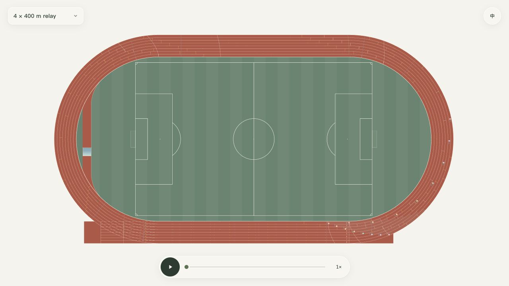

<div align="center">
  <h1>Athletics Simulator</h1>
  <p><a href="README.md">English</a> · <strong>简体中文</strong></p>
  <p>
    
    
    
    
    
    
  </p>
</div>

## 网站简介

Athletics Simulator 是一个在浏览器中运行的径赛模拟项目，用于规则演示、比赛路线研究，并为战术演练功能的二次开发提供基础。

全屏场地采用八道 400 米跑道，支持包含五种接力在内的 21 个项目。当前版本使用预设路线和统一演示配速，不预测比赛结果，也未提供战术编辑器。解释运动轨迹前，请先阅读[模型与项目变体说明](docs/model.zh-Hans.md)。



## 网站特性

🏟️ **按米建模的场地** — 跑道尺寸、错位起点、永久标线、抢道线、跨栏及障碍赛水池路线均使用场地米制坐标绘制，跑道内设有足球场。

🏃 **单人及接力路线** — 通过短跑、中长跑、跨栏、障碍与接力项目，对比分道跑、弧形起跑、两组起跑、抢道及交接过程。

🎛️ **直接操作的可视化** — 拖动和缩放场地，选中运动员或队伍后跟随，拖动进度条，并切换 0.25×、0.5×、1×、2×、4×、8× 播放倍数；切换项目保留视角。

🌐 **双语界面** — 支持英文与简体中文切换，始终以场地为界面主体。

🧩 **可扩展源码与检查** — 几何、运动、视角、渲染与项目数据片段构建为一个自包含 HTML 文件，并配有模型及交互回归测试。

## 快速开始

需要 Node.js 22 或更高版本及 npm。构建后的应用不依赖外部素材或运行时软件包。

```bash
git clone https://github.com/lailai0916/athletics-simulator.git
cd athletics-simulator
npm ci
npm run dev
```

打开 `http://127.0.0.1:5173`（或终端输出的本地地址）。开发服务器收到页面请求时会重新构建，修改源码后刷新页面即可查看。

如需离线使用，可从[最新发布](https://github.com/lailai0916/athletics-simulator/releases/latest)下载 `index.html`。文件包含代码许可，无需服务器即可打开。

构建并预览分发文件：

```bash
npm run build
npm run preview
```

`dist/index.html` 包含应用页面、样式与脚本，可以直接打开，也可由静态服务器托管。构建产物能够由源码重新生成，不纳入 Git 提交。

拖动场地平移，滚动鼠标滚轮缩放。点击运动员后跟随；跟随期间滚轮只改变缩放，拖动不移动视角。再次点击同一运动员，或在运动员获得键盘焦点时按 Escape，退出跟随。空格控制开始与暂停；项目菜单支持方向键、Home、End、Enter 和 Escape。

## 项目结构

```bash
athletics-simulator/
├── .github/                        # 持续集成、问题模板与协作规范
├── docs/                           # 模型假设、依据与开发文档
│   └── images/                     # 应用预览
├── scripts/                        # 共用源码组装、构建与本地服务器
│   ├── assemble.cjs                # 构建和测试共用的源码组装
│   ├── build.cjs                   # 自包含 HTML 构建产物
│   └── serve.cjs                   # 开发与预览 HTTP 服务器
├── src/                            # 浏览器应用与几何模块
│   ├── index.html                  # 页面外壳与 SVG 图层
│   ├── track-app.js                # 比赛状态、控件与模块集成
│   └── track-data.js               # 项目目录与参考参数
├── tests/                          # 几何、运动、渲染与输入回归
├── CHANGELOG.md                    # 版本变更
└── package.json                    # 命令与开发依赖
```

## 项目与模型范围

项目目录包含 100 米、200 米、300 米、400 米、800 米、1000 米、1500 米、1 英里、2000 米、3000 米、5000 米、10000 米、100 米栏、110 米栏、400 米栏、3000 米障碍，以及 4 × 100 米、4 × 200 米、4 × 400 米、4 × 800 米、4 × 1500 米接力。

为便于观察路线差别，模型统一采用 10 米/秒巡航速度及确定性的间距安排。部分比赛采用指定变体，例如 4 × 200 米演示全程分道版本。当前没有运动员生理模型、个体成绩校准、碰撞决策或裁判判罚引擎；目录不包含混合接力、公路项目与田赛。

[模型文档](docs/model.zh-Hans.md)区分规则尺寸、选用赛制与可视化安排，[参考依据](docs/references.zh-Hans.md)列出使用资料的版本和章节。本项目为独立实现，不属于官方或经认证的比赛系统。

## 开发与贡献

```bash
npm test
npm run build
npm run format:check
# 一次运行格式、回归与构建检查：
npm run check
```

[开发指南](docs/development.zh-Hans.md)介绍模块约定、项目扩展与浏览器验收；提交修改前请阅读[贡献指南](.github/CONTRIBUTING.md)。持续集成检查格式、项目回归、构建产物与仓库规范。Node 测试通过不能证明真实浏览器的视觉精度或 Safari 性能。

反馈问题时，请提供项目、分组起跑设置、播放位置、视角及跟随状态、浏览器版本与复现步骤。安全漏洞请按[安全政策](.github/SECURITY.md)私下报告。

## 许可协议

本项目代码采用 [MIT 许可协议](LICENSE)，项目文档采用 [CC BY 4.0 许可协议](LICENSE-docs)。
